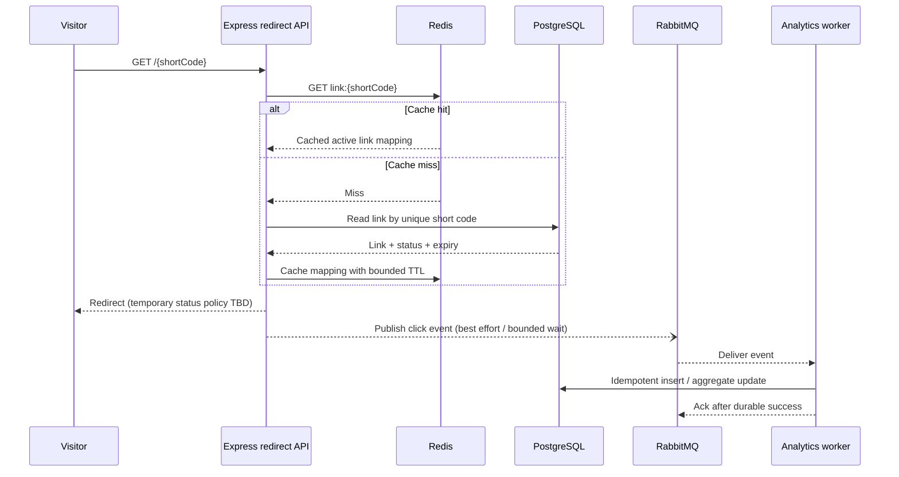

# Pulse — Architecture baseline

**Version:** 0.1 (M0)
**Status:** Proposed baseline for owner review
**Last updated:** 31 October 2026

## 1. Architecture principles

1. **Local-first and zero-cost:** the complete MVP must run locally with Docker Compose and open-source components.
2. **Modular monolith first:** one repository and clear application modules; a separate worker process for asynchronous analytics. No early microservices split.
3. **PostgreSQL is the source of truth:** Redis is disposable acceleration/state, not the canonical store for links or analytics.
4. **Keep the redirect path small:** resolve, validate lifecycle status, redirect, emit analytics. Do not synchronously aggregate analytics or fetch destination metadata.
5. **Explicit asynchronous boundaries:** RabbitMQ carries versioned click events to a worker. Consumers must tolerate redelivery.
6. **Security at boundaries:** authenticate, authorize, validate, normalize and rate-limit at server-controlled boundaries.
7. **Evidence over claims:** test failure modes and benchmark with documented methodology.
8. **Human-approved architecture:** significant changes require an ADR and owner approval.

## 2. Logical components

### Next.js web application

Responsible for product pages, account UI, link management, analytics presentation and client-side experience. It communicates with the API through a clearly defined API contract. It must not bypass backend authorization by directly trusting data from client state.

### Express API / redirect service

Responsible for authentication/session endpoints, link CRUD, public short-code resolution, validation, ownership checks, cache access, event publication and consistent errors. Route handlers should remain thin; business logic should be grouped in explicit modules/services.

### PostgreSQL

Durable source of truth for users, links, ownership, event identity and analytics/aggregates. Use schema constraints, indexes and migrations. Query plans and connection-pool behaviour should be inspected when performance work begins.

### Redis

Used for:

- cache-aside short-code-to-link lookup;
- shared rate-limit counters/state if needed;
- optional short-lived negative cache.

Redis is not the source of truth. A Redis loss or flush must not permanently lose link data. Do not use Redis as the analytics broker in the approved baseline; RabbitMQ keeps caching and message delivery as separate concerns.

### RabbitMQ

Carries click events from the redirect service to the analytics worker. Define durable queue/exchange, message persistence, publisher-confirm approach, acknowledgement timing, bounded retries and dead-letter handling during M4. Do not assume broker publication alone guarantees database processing.

### Analytics worker

A separate process in the same codebase. It consumes validated events, applies idempotency, writes analytics records/aggregates and acknowledges messages only after durable processing. Concurrency and retry settings must be bounded and observable.

## 3. Initial deployment topology

Docker Compose should orchestrate local containers for:

- web application;
- API/redirect service;
- PostgreSQL;
- Redis;
- RabbitMQ;
- analytics worker.

During development, app processes may be run directly on the host or in containers depending on workflow, but the documented default should be repeatable and unambiguous. Add health checks, dependency readiness and persistent local data volumes. Never bake secrets into images or commit populated `.env` files.

## 4. Redirect sequence



The exact sequencing between responding to the visitor and publishing the event is an implementation decision that must be explicitly tested. The product prioritizes redirect availability, but the event-loss window must not be hidden. If event delivery requirements later demand stronger guarantees, evaluate a transactional outbox ADR.

## 5. Cache strategy

Baseline is cache-aside:

- Key: namespaced key such as `link:<shortCode>`.
- Value: minimal mapping needed for redirect, including status/expiry/version fields required to enforce lifecycle semantics.
- Cache only active and unexpired links.
- Use bounded TTL rather than indefinite caching.
- On miss, read PostgreSQL and populate cache.
- For invalid codes, optionally use a short negative-cache TTL to protect the DB from repeated random probes.
- After link edit/disable/delete, commit the database transaction, then invalidate relevant cache keys.
- If invalidation fails, emit an error/metric and rely on a documented upper bound for stale cache; revisit stronger invalidation if evidence warrants it.
- If Redis is unavailable, fall back to PostgreSQL and keep redirects working within DB capacity limits.

Potential race: a redirect may read a cached mapping while an edit/disable is being committed. Define acceptable consistency window and test concurrent update/resolve behaviour. Do not claim immediate consistency while caching stale values.

## 6. Short-code generation direction

Use cryptographically secure random Base62-like codes as the initial approach. Base62 is an encoding/alphabet choice, **not** an ID-generation algorithm by itself. Avoid sequential database IDs encoded as Base62 because they are enumerable. Enforce uniqueness in PostgreSQL and retry a collision a bounded number of times. Choose initial code length based on collision probability, usability and URL length; document the calculation in the relevant ADR before implementation. Do not use timestamps or `Math.random()` for security-sensitive code generation.

## 7. Data and ownership boundaries

Conceptual entities are User, Link, ClickEvent and optional analytics aggregates. Link records are owned by a user. Every read/update/delete/analytics query must be scoped to the authenticated owner's identity. A random UUID or difficult-to-guess ID is not a replacement for authorization.

Event records need a stable event identity and schema version to support deduplication and future evolution. Prefer UTC timestamps internally and explicit display timezone handling in the UI.

## 8. API boundary conventions

- Versioning strategy should be selected before API surface stabilizes.
- Use Zod for request, query, params, environment and message parsing.
- Use consistent response/error envelopes without leaking stack traces.
- Separate authentication from authorization checks.
- Apply pagination limits and input bounds to list/analytics endpoints.
- Treat redirect endpoints separately from authenticated JSON APIs.
- Use safe HTTP headers, narrow CORS and cookie policy aligned with the frontend origin.

## 9. Analytics event contract direction

Initial event shape (illustrative, not yet a finalized schema):

```json
{
  "eventId": "cryptographically-random-event-id",
  "schemaVersion": 1,
  "linkId": "stable-link-id",
  "occurredAt": "2026-10-31T18:30:00.000Z",
  "referrer": "https://example.com/path",
  "userAgent": "browser-provided-value"
}
```

Do not persist raw IP by default. Any derived device/browser fields should be produced through a controlled, tested parser and stored at an appropriately coarse level. Strip query strings/fragments from referrers where practical. Treat every field as untrusted input. The final event schema, privacy handling and retention policy must be approved before M4.

## 10. Failure behaviour baseline

| Failure | Expected behaviour | Evidence required |
|---|---|---|
| Redis unavailable | Redirect falls back to PostgreSQL; cache-dependent rate limiting has a deliberate fallback policy | Integration/failure test and structured warning |
| RabbitMQ unavailable | Valid redirect remains available where possible; event may be lost unless a future durable handoff is approved | Failure test, event-loss metric/log, documented limitation |
| Worker down | Queue retains messages within configured broker durability/retention policy; redirect continues | Stop/restart worker and verify recovery |
| Duplicate event | No double counting | Replay same event ID and verify result |
| Worker crash before ack | Message can be redelivered; idempotency prevents double count | Crash/retry test |
| Poison message | Bounded retry then dead-letter; no infinite hot loop | DLQ test and operator visibility |
| PostgreSQL unavailable | CRUD fails safely; redirect cache-hit behaviour must be deliberately defined; no claim of unlimited cache-only availability | Dependency failure test |
| Cache invalidation failure | Error observable; stale window bounded by TTL or stronger strategy | Simulated failure test |
| Invalid/disabled/expired link | Safe non-redirect response; no internal details | API/route tests |

## 11. Observability baseline

Start with structured JSON logs and request correlation IDs. Avoid secrets and sensitive payloads. Add metrics for request count/latency/status, redirect cache hit/miss, DB query latency/pool saturation, rate-limit actions, event publish failures, queue depth, consumer lag, retry/DLQ counts and worker processing duration. Add tracing when it improves diagnosis across API -> broker -> worker. Local tooling must remain free; OpenTelemetry-compatible instrumentation can be exported to a local collector or simple logs during development.

## 12. Security architecture

The architecture security baseline is detailed in [`SECURITY-CHECKLIST.md`](SECURITY-CHECKLIST.md). Especially important: owner-scoped access, strict URL scheme validation, no server-side URL fetching in MVP, safe session handling, rate limits on high-risk endpoints, event validation, safe logging and controls for abuse/takedown.

## 13. Future deployment mapping

AWS is intentionally excluded from the first running architecture due to the hard zero-cost constraint. A future architecture note may map components to AWS equivalents (for learning or optional deployment) but must clearly label this as a conceptual mapping or an actually deployed design. Do not provision cloud resources without explicit cost approval.
